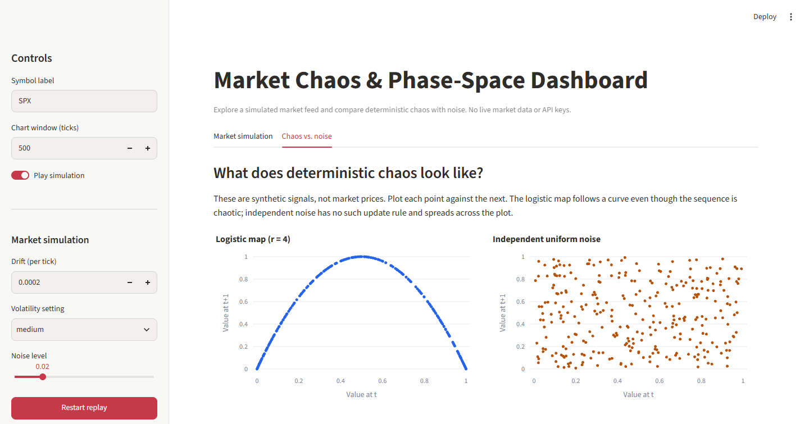

# Market Chaos & Phase-Space Dashboard

An interactive Python and Streamlit dashboard for exploring phase space,
volatility, and chaos metrics on **simulated market data**. Watch a seeded price
simulation, then compare the phase-space plot of a chaotic logistic map with
independent noise. No account, API key, or market data connection is needed.

**[Try Chaos vs. Noise in your browser](https://0xmrpinheiro.github.io/market-chaos-phase-space-dashboard/)**
— the lightweight demo needs no installation. The full Streamlit dashboard runs locally below.



## Quick start

Use Python 3.11 or newer. Installing packages requires an internet connection;
the simulation runs locally after that.

```bash
git clone https://github.com/0xmrpinheiro/market-chaos-phase-space-dashboard.git
cd market-chaos-phase-space-dashboard
```

**macOS / Linux**

```bash
python3 -m venv .venv
.venv/bin/python -m pip install -r requirements.txt
.venv/bin/python -m streamlit run app.py
```

**Windows PowerShell**

```powershell
python -m venv .venv
.\.venv\Scripts\python.exe -m pip install -r requirements.txt
.\.venv\Scripts\python.exe -m streamlit run app.py
```

Open `http://localhost:8501`. Both tabs have charts immediately; there is no
need to wait for the price buffer to fill.

## Try it

1. **Chaos vs. noise:** The logistic map (`x[t+1] = 4x[t](1−x[t])`) traces a
   curve when each value is plotted against the next. Independent uniform noise
   has no equivalent update rule, so its points spread across the same axes.
2. **Market simulation:** Adjust drift, volatility, or noise, and see how new
   ticks change the price chart and the consecutive-price scatter plot. The chart
   window controls visible history; the metrics use up to the latest 256 ticks.
3. **Play simulation** pauses or resumes new ticks. **Restart replay** reseeds
   the generator and redraws the initial sample with the selected settings.
   The symbol is a label, not a live ticker lookup.

## What the metrics mean here

| Metric | What it estimates |
| --- | --- |
| Lyapunov exponent | How quickly nearby paths in the price embedding separate. A positive estimate on noisy data is not proof of deterministic chaos. |
| Hurst exponent | Persistence or anti-persistence in simulated returns, estimated with rescaled range analysis. |
| Correlation dimension | How the fraction of nearby point pairs scales with distance in the price embedding. |
| Sample entropy | How often similar return patterns stay similar after adding one more observation. |

The displayed labels use illustrative thresholds, not a validated market-regime
classifier. The dashboard does not predict prices or test real markets for chaos.

## Development

From the repository root, with the virtual environment activated:

```bash
python -m unittest discover -s tests -v
```

- [`app.py`](app.py) — Streamlit views and replay controls
- [`data_feed.py`](data_feed.py) — seeded market simulator and reference signals
- [`chaos_metrics.py`](chaos_metrics.py) — metric estimators and heuristic labels
- [`tests/`](tests/) — replay and app smoke tests

## License

[MIT](LICENSE)